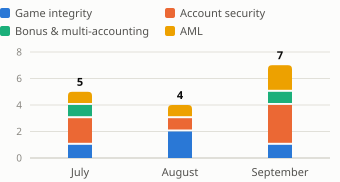
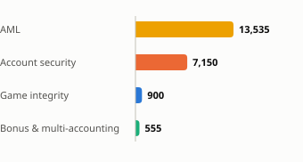

# Monthly fraud trends - September 2026

_Demo crypto poker room · synthetic data · new cases opened in September, compared with July and August. Generated by `python run.py`._

| New cases | Accounts involved | Money at risk | P1 cases (review today) |
|---|---|---|---|
| **7** (▲ 3 vs August) | **22** (▲ 13 vs August) | **22,139 USDT** (▲ 8,132 USDT vs August) | **2** (▲ 1 vs August) |

### New cases per month by type

### Money at risk in September's new cases (USDT)

## What changed in September

- **Account takeover: 4 flags (vs 1 in August).** 3 were one campaign: the same device, IP and payout wallet on consecutive nights, 6,510 USDT withdrawn, all from hosting (server/VPN) IPs. 1 other flag looks like a traveller's new phone (the 'new' device was later used from home): probably a false positive, to confirm with the player.
- **Bonus abuse: a farm of 12 linked accounts (largest before: 5 in July).** Opened within 6 days, all with disposable emails; each took the welcome bonus and they cashed out 555 USDT. Small money, but the pattern is scaling.
- **AML: 2 new accounts moved 5,800 USDT through with almost no play.** They shared a payout wallet, and all switched from BTC/ETH to USDT on the way. Separately, P01879 made 4 deposits just under the 2,000 USDT review threshold in a week (structuring). All of these go to the MLRO; the players are not told why.
- **Game integrity:** 1 new chip dumping case (900 USDT); still active from earlier months: the August chip dumping group (5 accounts, until 3 Sep), the July collusion group (3 accounts, until 28 Sep), the August collusion group (2 accounts, until 29 Sep).

## Rings and campaigns active in September

| Case | Type | Accounts | Active | Money at risk | Priority |
|---|---|---|---|---|---|
| FR-2608-02 | Chip dumping + Multi-accounting | 5 | 08-10 → 09-03 | 7,090 USDT | P1 |
| FR-2609-07 | Account takeover | 3 | 09-21 → 09-23 | 6,510 USDT | P1 |
| FR-2607-02 | Collusion / soft-play + Multi-accounting | 3 | 07-05 → 09-28 | 1,200 USDT | P1 |
| FR-2609-02 | Bonus abuse + Multi-accounting | 12 | 09-03 → 09-12 | 555 USDT | P2 |

## Recommended actions

- **Step-up check on new-wallet withdrawals.** Ask for 2FA or email confirmation when a withdrawal goes to a never-used wallet within 24 h of a login from a new device and country. It would have challenged every takeover withdrawal this month; the cost is one extra step for travellers.
- **Make the welcome bonus slower to cash out:** hold it for 7 days or 100 hands, and refuse it to devices and wallets already linked to a claimed bonus.
- **Send this month's AML cases to the MLRO** and screen the shared payout wallet with blockchain analytics; hold large deposits that are withdrawn almost unplayed for manual review.
- **Alert in real time when linked accounts open a two-seat table together:** 100% of the hands between flagged chip-dumping pairs this quarter were played at one.

## Rule health

7 rules, 16 cases this quarter; 3 shared identifiers ignored as too common to identify anyone (carrier gateway, VPN exit, exchange wallet). Against the planted answer key: 14/14 fraud scenarios caught, 7/7 innocent look-alikes left alone. Known false-positive pattern: 2 takeover flags where the 'new' device was later used from home (a traveller's new phone) - which is why every flag goes to a human.

_All figures come from synthetic data (2,000 fictional players, July-September 2026). Case details: [case_list.md](case_list.md); rule logic: [rules/](../rules/)._
